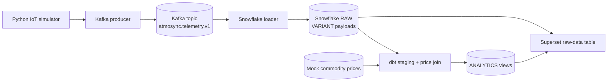

# AtmoSync — Micro-Climate Arbitrage Analytics

AtmoSync is a Week 1–2 implementation of a streaming data-analytics project for a commodities trader. It tracks container-level temperature, humidity, and vibration so that perishable cargo can be monitored before a local climate change becomes a costly spoilage event.

This repository deliberately stops at the **mid-project review** boundary. It implements ingestion, raw storage design, cleaning/joining models, and baseline dashboard specifications. The Week 3 spoilage-arbitrage calculation and Week 4 alerting/orchestration are documented as future work, not represented as completed features.

## What is included

| Assignment requirement | Deliverable in this repository |
| --- | --- |
| Python IoT simulator | `src/atmosync/simulation/sensor_simulator.py` |
| Kafka topic and streaming producer | `src/atmosync/streaming/kafka_producer.py`, `docker-compose.yml` |
| Snowflake raw storage | `sql/snowflake/00_bootstrap.sql`, `snowflake_loader.py` |
| dbt staging / price join | `dbt_atmosync/models/` and `data/mock/commodity_prices.csv` |
| Superset foundations and baseline visuals | `superset/` and `docs/SUPERSET_SETUP.md` |
| Mid-review evidence plan | `docs/MID_PROJECT_REVIEW.md` |
| Week 1 and Week 2 submissions | `docs/WEEK_1_WRITE_UP.md`, `docs/WEEK_2_WRITE_UP.md` |

## Architecture



## Quick start — code-only verification

The simulator and unit tests use only the Python standard library.

```bash
export PYTHONPATH=src
make test
python3 -m atmosync.simulation.sensor_simulator --count 5 --interval-seconds 0
python3 -m atmosync.streaming.kafka_producer --dry-run --count 5 --interval-seconds 0
```

## Open the local review dashboard

For a browser-ready Week 1–2 demo that needs no Docker or Snowflake account:

```bash
make dashboard
```

Open [http://localhost:8000](http://localhost:8000). The dashboard visualizes the same deterministic simulator data used by the project: temperature trend, Container A’s controlled drift, route health, alerts, and raw-event fields. It clearly labels itself as a **local simulated demo**; the separate Superset instructions remain the connected-environment deliverable. See [docs/LOCAL_DASHBOARD.md](docs/LOCAL_DASHBOARD.md).

## Run the local development services

1. Copy `.env.example` to `.env` and replace all Snowflake placeholders. Do not commit `.env`.
2. Start Kafka, Postgres, Redis, and Superset:

   ```bash
   docker compose up -d
   ```

3. Create the Snowflake role, warehouse, tables, and raw schema by running `sql/snowflake/00_bootstrap.sql` as an account administrator. Run `sql/snowflake/01_grants.sql` after confirming the analyst users.
4. Install runtime packages, then create the Kafka topic and begin publishing:

   ```bash
   python3 -m venv .venv
   . .venv/bin/activate
   pip install -r requirements.txt
   export PYTHONPATH=src
   python3 -m atmosync.streaming.kafka_producer --create-topic --count 0
   python3 -m atmosync.streaming.kafka_producer --count 500 --interval-seconds 0.05
   ```

5. In a second terminal, load Kafka payloads into Snowflake:

   ```bash
   export PYTHONPATH=src
   python3 -m atmosync.streaming.snowflake_loader --max-messages 500
   ```

6. Create and compile the dbt models:

   ```bash
   cd dbt_atmosync
   cp profiles.yml.example profiles.yml
   # edit profiles.yml or use the required SNOWFLAKE_* environment variables
   dbt seed
   dbt build
   ```

7. Open Superset at `http://localhost:8088`, connect using the Snowflake SQLAlchemy URI in [docs/SUPERSET_SETUP.md](docs/SUPERSET_SETUP.md), then create the documented baseline charts.

## Repository map

The source code is in `src/atmosync/`; Snowflake scripts in `sql/snowflake/`; dbt models in `dbt_atmosync/`; Superset specifications in `superset/`; mock data in `data/mock/`; and review/write-up material in `docs/`.

See [docs/PROJECT_OVERVIEW.md](docs/PROJECT_OVERVIEW.md) for the business rationale and scope, and [docs/MID_PROJECT_REVIEW.md](docs/MID_PROJECT_REVIEW.md) for exactly what must be shown during review.
